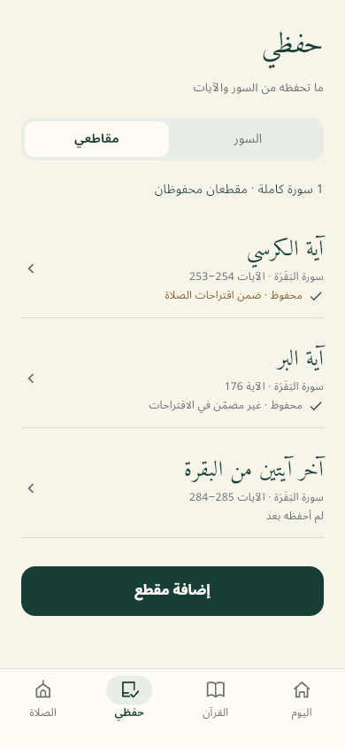
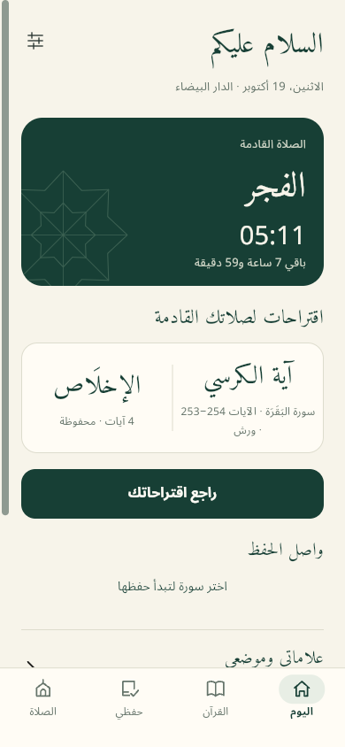
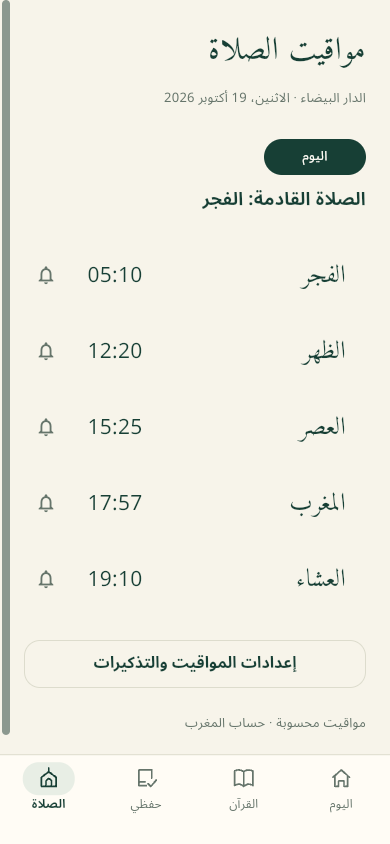

# سُوَر · Suwar

**A personal Quran companion for reading, memorization and daily prayer.**

Suwar brings the Warsh Quran, named passages, focused practice and prayer suggestions into an Arabic RTL Flutter app. Current version: **0.6.1+7**. Its ivory, deep green and gold interface follows the editable FigCraft designs.

**No account. No application backend. Your progress stays on your device.**

[Get started](#get-started) · [Features](#features) · [Build and release](docs/RELEASE.md) · [Design and verification](#design-and-verification)

## A look inside

<table>
<tr>
<td align="center"><br><strong>Make it personal</strong></td>
<td align="center"><br><strong>Build a daily rhythm</strong></td>
<td align="center"><br><strong>Stay ready for prayer</strong></td>
</tr>
</table>

Actual browser captures from version 0.6.1, using illustrative saved progress. Verse numbers use Western digits (0–9); scripture words, diacritics and source numbering are preserved.

## Features

| Experience | What you can do |
| --- | --- |
| **Read** | Browse all 114 surahs and 6,214 source ayahs, search by name or number, adjust Quran text size, and return to an exact saved ayah. |
| **Remember** | Mark whole surahs memorized, practise a verse with hide/reveal, and repeat its audio 1, 3 or 5 times. |
| **Save passages** | Name one ayah or a contiguous range within one surah. Preview the complete text before saving; track its memorization independently. |
| **Prepare for prayer** | Receive up to two nonoverlapping suggestions from memorized surahs and explicitly included memorized passages. |
| **Listen** | Stream Mahmoud Khalil Al-Hussary’s Warsh recitation, or explicitly download surahs for native offline playback. |
| **Keep continuity** | Save bookmarks, complete a daily review selection, and export or restore a validated local JSON backup. |
| **Prayer tools** | Calculate times offline for eight Moroccan cities, configure Android reminders, and request an Android next-prayer home-screen widget. |

### Named passages, without changing your whole-surah progress

Open **حفظي → مقاطعي → إضافة مقطع**, choose a preset or your own ayah range, give it an optional name, and preview the exact source text. You can also begin from an ayah’s reader menu.

Saving a passage and knowing it by heart are separate choices. Prayer inclusion starts off and requires explicit memorization. Renaming keeps those choices; changing the ayahs resets them after confirmation. Overlapping passages may coexist in your collection, but never appear together in a suggestion pair.

The bundled Warsh numbering is authoritative: the complete Ayat al-Kursi passage is **Al-Baqara 253–254**, Al-Birr is **176**, and the final two ayahs are **284–285**. These are source-specific references, not Hafs numbering.

## What works where

| Capability | Android | Browser / web | iOS |
| --- | --- | --- | --- |
| Quran, practice, passages and local progress | Implemented | Implemented | Scaffold; native verification pending |
| Audio streaming | Implemented | Implemented | Native verification pending |
| Explicit offline audio downloads | Implemented | Streaming only | Native verification pending |
| Prayer calculations | Implemented | Implemented | Native verification pending |
| Scheduled prayer notifications / launcher widget | Implemented | Unavailable | Unavailable |

Quran text and fonts are bundled. Audio requires a connection for streaming or the first download. Downloaded recordings remain separate from your progress and backup files.

Prayer times are calculated estimates, not an official timetable. Moroccan clocks use corrected, timestamp-aware rules (currently UTC+00), independently of the phone’s timezone; see [time-zone handling](docs/TIME_ZONES.md). Android reminders require permission; exact alarms need separate optional device access. Delivery may be approximate. The app maintains a rolling 30-day schedule and renews it on relevant edits, foreground date checks or reopening. Reopen before the displayed coverage date.

Playback starts explicitly and stops when leaving the relevant route, hiding a verse for recall or backgrounding the app. There is no background audio service, recording or automatic next-ayah playback.

## Get started

Developed with **Flutter 3.38.5 / Dart 3.10.4**. Install a compatible Flutter SDK and the platform tooling for your target, then run from this directory:

```sh
flutter pub get
flutter run -d chrome --web-port 7358
```

For Android, connect a device or start an emulator:

```sh
flutter devices
flutter run -d <device-id>
```

VS Code launch configurations are included. Offline dependency resolution is available with `flutter pub get --offline` when the required packages are already cached.

### Checks

```sh
flutter analyze
flutter test
```

The [Android APK workflow](https://github.com/HamzaMPSY/suwar/actions/workflows/android-apk.yml) runs on pushes and pull requests to `main`, and from **Run workflow**. After a successful run, download the **suwar-pixel-arm64-development-signed** artifact from the run page and extract its APK. It includes a SHA256 checksum and build metadata; see [CI builds](docs/RELEASE.md#github-actions-apk-download).

CI uses a runner-generated debug certificate. It can update an existing Pixel installation only if the signing certificates match; export a backup before any signing migration. For local artifacts and signing details, see [Build and release](docs/RELEASE.md).

## Data and backups

Progress is local to the current app installation or browser profile. There is no cloud synchronization. Clearing application/browser storage removes local progress; export a backup when you want a portable copy.

Backup v2 includes whole-surah progress, saved passages, reading position, bookmarks, daily review and prayer settings. Import validates the source identity and data, shows a replacement preview, and asks for confirmation. Legacy v1 backups are accepted with an explicit warning that they contain no passages. A recoverable five-store journal protects replacement. Restored reminders remain off until you enable them again.

Audio files and device permissions are excluded from backups. Download deletion preserves memorization and prayer settings.

## Design and verification

FigCraft remains the design source; no Stitch is used.

| Reference | Purpose |
| --- | --- |
| [Main design](design/Suwar.figcraft) · [Design system](DESIGN.md) | Original visual direction and reusable foundations |
| [Passage design](design/Suwar-passages.figcraft) | Approved named-passage flows and states |
| [Build and release](docs/RELEASE.md) | Toolchain, checks, artifact creation and release limits |

Automated checks cover immutable Quran text, source numbering, persistent state, backup recovery, suggestion eligibility, prayer calculations and widget layouts. Browser flows and responsive layouts are reviewed against FigCraft. Android builds use development signing; fresh native interaction and keyboard verification requires an available device. iOS distribution remains unvalidated.

## Project map

```text
lib/core/           Theme, Quran repository, shared state and session lifecycle
lib/features/       Reading, memory, passages, prayer, audio and personal tools
assets/quran/       Immutable Warsh source and provenance
assets/audio/       Pinned recitation timing catalog and attribution
assets/fonts/       Bundled Arabic fonts
test/               Domain, persistence, integration and widget checks
design/             Editable FigCraft documents and reference exports
docs/RELEASE.md     Reproducible build and future publishing guidance
```

## Content, attribution and licensing

Quran text and the matching Warsh font come from the supplied KFGQPC source assets. The source text is preserved exactly; search normalization does not rewrite scripture. See the [Warsh source notes](assets/quran/warsh-README.md) and [dataset provenance](assets/quran/quran-data-README.md).

The app bundles publisher timing metadata for MP3Quran’s identified Husary Warsh recording, not the recordings themselves. Streaming and explicit downloads contact that provider. See [audio provenance and permission notes](assets/audio/PROVENANCE.md). Structural timing validation does not claim that every spoken boundary has been independently audited.

Amiri’s [OFL license](assets/fonts/Amiri-OFL.txt) is included; Noto font metadata remains in its TTF. Review the recorded Quran dataset and Warsh font redistribution terms before public distribution.

**No license has been selected for the application’s own code.** Third-party content and dependency terms remain separate; this README does not grant a new license.
